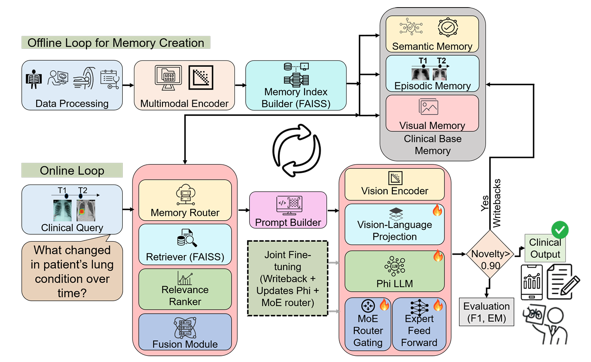
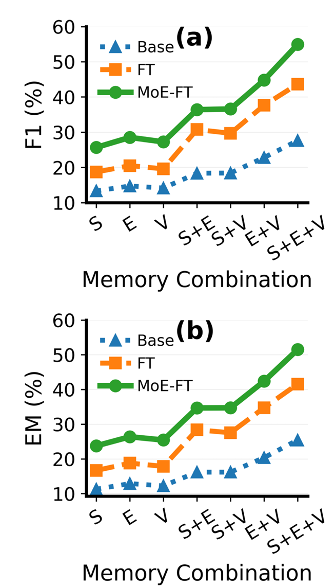
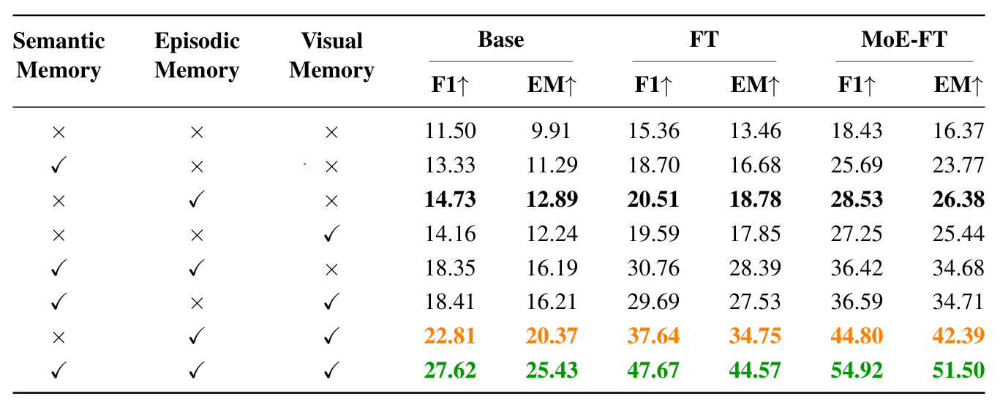
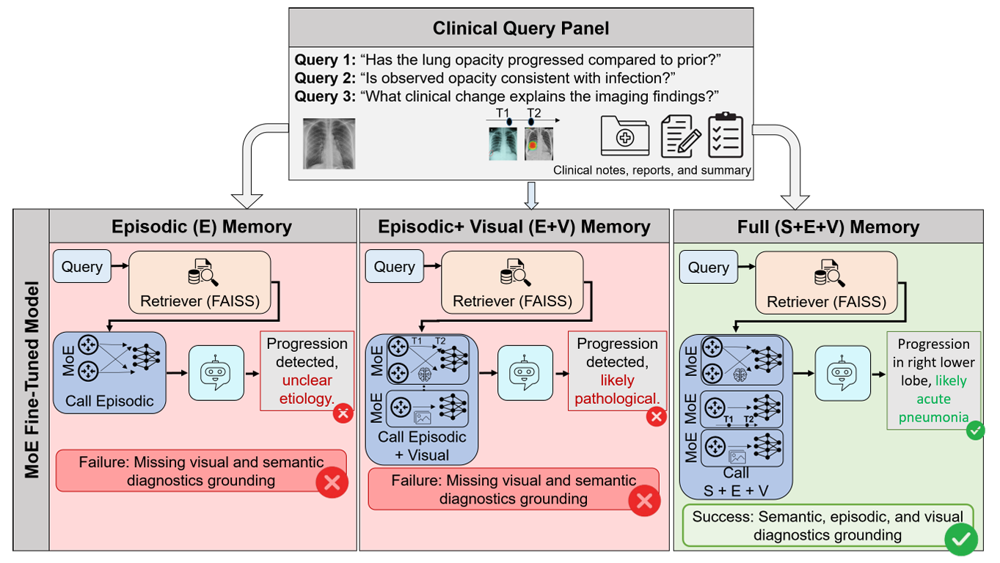

# MSM-Mem: Medical Structured Multimodal Memory for Medical AI Agents

[](https://arxiv.org/abs/2608.21810)


This is the official code for **"MSM-Mem: A Universal Medical Structured Multimodal Memory Framework for Medical AI Agents"** by Md Asaduzzaman Jabin, Khoa Le, Lin Zhao and Tianming Liu (University of Georgia; New Jersey Institute of Technology).

> **Names:** the paper also calls the framework **Bio-Mem**, and this repository is named **Bio-Med-Agent**. All three names refer to the same system.

---

## Contents

- [Overview](#overview)
- [Repository structure](#repository-structure)
- [Installation](#installation)
- [Data](#data)
- [Models](#models)
- [Running MSM-Mem](#running-msm-mem)
- [Reproducing the paper](#reproducing-the-paper)
- [Key settings](#key-settings)
- [Memory format](#memory-format)
- [Results](#results)
- [Reproducibility status](#reproducibility-status)
- [Citation](#citation)
- [License and acknowledgements](#license-and-acknowledgements)

---

## Overview

Medical agents built on multimodal LLMs are usually **stateless**: they do not keep experience from one case to the next. MSM-Mem adds a structured memory with three parts that grows during inference.

| Memory | What it stores | Used for |
|---|---|---|
| **Episodic (M_E)** | Past query → response → decision episodes, keyed by an image embedding | Recalling similar prior cases |
| **Visual (M_V)** | Image prototypes with a view tag | Comparing at the visual level |
| **Semantic (M_S)** | A rolling per-patient summary of prior impressions | Longitudinal patient context |

<p align="center">
  
</p>
<p align="center"><em><b>Figure 2.</b> MSM-Mem agent self-evolving architecture. (a) Offline loop: encoding, memory builder, building the base memory. (b) Online loop: run queries, retrieve from base and writeback memory, query the fine-tuned foundation model, adaptive routing.</em></p>

For each case, the agent:

1. Encodes the current image with **ImageBind**, producing a 1024-d, L2-normalized embedding.
2. Retrieves the top-k episodic and visual items for the same patient with **FAISS** cosine search.
3. Adds the patient's semantic summary.
4. Fuses everything into a structured prompt for **MoE-LLaVA**, which writes the `Findings:` and `Impression:` sections.
5. **Writes back** the new experience only if it passes three gates: *novelty* (it is not too similar to stored cases), *length* (the impression is long enough), and *clinical keyword* (it mentions a change or an important finding).

```text
image ──ImageBind──► z ──FAISS top-k──► episodic hits ┐
                       └──FAISS top-k──► visual hits   ├─► prompt ─► MoE-LLaVA ─► Findings / Impression
patient_id ─────────────────────────────► semantic     ┘                              │
                                                                                       ▼
                         memory ◄── writeback if  novel ∧ long enough ∧ clinical keyword
```

The paper evaluates three backbones: **MoE-LLaVA Base**, a regular fine-tune (**FT**), and a router-only MoE fine-tune (**MoE-FT**). All are evaluated on a curated **MIMIC-CXR** subset.

---

## Repository structure

```text
Bio-Med-Agent/
├── main_run.py                 # single-query demo (image or video)
├── memory/
│   ├── episodic_store.py       # EpisodicStore: FAISS IndexFlatIP + episodic.jsonl   (M_E)
│   ├── visual_store.py         # VisualStore: FAISS IndexFlatIP + visual.jsonl       (M_V)
│   ├── semantic_store.py       # SemanticStore: per-patient JSON summary             (M_S)
│   └── prompt_builder.py       # build_prompt(): fuses S/E/V memory + question
├── models/
│   ├── moe_llava_infer.py      # MoELLaVAInfer: token-budget shrink, keyword stopping
│   └── llava_phi_infer.py      # LlavaPhiInfer: non-MoE wrapper
├── tools/
│   ├── encoder_imagebind.py    # ImageBindEncoder: 224×224, CLIP norm, L2, d=1024
│   └── keyframe.py             # video keyframe extraction
├── pipelines/
│   ├── remove_bad.py           # drop rows without question/answer
│   ├── shuffle_jsonl.py        # seeded subject-balanced shuffle
│   ├── split_jsonl.py          # line-range splitter
│   ├── preprocess_dataset.py   # resolve paths, choose keyframes
│   ├── build_memory.py         # OFFLINE loop: build base memory from ground truth
│   └── eval_runner.py          # ONLINE loop: retrieve → generate → score → (gated) writeback
├── scripts/
│   ├── moellava_full_ablation.sh            # Base backbone pipeline
│   ├── moellava_memory_writeback_regular.sh # FT backbone pipeline
│   ├── moellava_memory_writeback_moe.sh     # MoE-FT backbone pipeline
│   ├── image-inference.sh, video-inference.sh   # demos
│   └── plot/                   # figure scripts + the numbers behind them (CSV)
├── checkpoints/                # FT / MoE-FT configs + tokenizers (weights hosted separately)
├── MoE-LLaVA/                  # vendored MoE-LLaVA (modified: builder.py, train.py, phi2 scripts)
├── ImageBind/                  # vendored ImageBind
├── requirements.txt
└── environment.yaml
```

---

## Installation

The experiments were run on Linux with **NVIDIA A5000** GPUs, Python 3.10 and the CUDA 11.8 toolkit.

```bash
git clone https://github.com/asad14053/Bio-Med-Agent.git
cd Bio-Med-Agent

# Option A: conda (creates an env named "Bio-Med-Agent")
conda env create -f environment.yaml
conda activate Bio-Med-Agent

# Option B: venv
python3.10 -m venv venv && source venv/bin/activate
pip install -r requirements.txt
```

**Important:** install the **vendored** MoE-LLaVA and ImageBind. This repo's MoE-LLaVA has local changes that the upstream package does not have.

```bash
pip install -e ./MoE-LLaVA
pip install -e ./ImageBind
pip install pandas matplotlib      # only needed for the plot scripts
```

Check the install:

```bash
python -c "import moellava, faiss; from imagebind.models.imagebind_model import imagebind_huge; print(moellava.__file__)"
# moellava.__file__ should point inside ./MoE-LLaVA
```

> Run every pipeline from the **repository root** as a module (`python -m pipelines.<name>`) so that `memory/`, `models/` and `tools/` can be imported.

---

## Data

The paper uses a **curated subset of [MIMIC-CXR](https://physionet.org/content/mimic-cxr/)**: chest radiographs, radiology reports and reasoning-oriented QA pairs. MIMIC-CXR requires **PhysioNet credentialed access**, so **no data is distributed with this repository**. In the code and scripts this dataset is called `tb_v1`.

### Layout (`data/` is git-ignored)

```text
data/
├── datasets/tb_v1/files/...                 # images (MIMIC-style paths)
├── preprocess/tb_v1/v1/
│   ├── preprocess_manifest_finetune.jsonl     # 60%  FT / MoE-FT training
│   ├── preprocess_manifest_base.jsonl         #  4%  base memory
│   ├── preprocess_manifest_writeback1.jsonl   #  6%  WB1
│   ├── preprocess_manifest_writeback2.jsonl   #  6%  WB2
│   ├── preprocess_manifest_writeback3.jsonl   #  6%  WB3
│   ├── preprocess_manifest_writeback4.jsonl   #  8%  WB4
│   └── preprocess_manifest_evaluate.jsonl     # 10%  held-out evaluation
└── memory_db/base/tb_v1/v1/...              # memory stores, one folder per phase
```

The splits are made at the subject level.

### Manifest format (one JSON object per line)

```json
{"qa_id": "q_000001", "subject_id": "10000032", "media_type": "image",
 "media_path": "files/p10/p10000032/s50414267/abc.jpg", "view": "PA",
 "question": "Describe the findings and impression for this chest radiograph.",
 "answer_gt": "Findings: ... Impression: No acute cardiopulmonary process."}
```

The code also accepts these alternative field names: `id` for `qa_id`, `patient_id` for `subject_id`, `type` for `media_type`, `path` for `media_path`, and `answer` or `report` for `answer_gt`.

### Preprocessing

```bash
python -m pipelines.shuffle_jsonl --in_jsonl raw.jsonl --out_jsonl shuffled.jsonl --seed 42 --mode balanced --key subject_id

python -m pipelines.preprocess_dataset \
  --manifest <split>.jsonl \
  --out_items data/preprocess/tb_v1/v1/preprocess_manifest_<split>.jsonl \
  --frames_root data/tmp_frames \
  --data_root data/datasets/tb_v1
```

---

## Models

| Paper name | Model | `--model_path` | Training |
|---|---|---|---|
| **Base** | MoE-LLaVA-Phi2-2.7B, 4 experts | `LanguageBind/MoE-LLaVA-Phi2-2.7B-4e` | public checkpoint |
| **FT** | LLaVA-Phi2 (dense) | `checkpoints/MoE-LLaVA-Phi2-finetune-Regular` | `MoE-LLaVA/scripts/v1/phi2/finetune.sh`: Phi-2 + CLIP-L/336 projector, 1 epoch, LR 5e-5, 8 GPUs |
| **MoE-FT** | MoE-LLaVA-Phi2, 8 experts, top-2 | `checkpoints/MoE-LLaVA-Phi2-finetune-MoE` | `MoE-LLaVA/scripts/v1/phi2/finetune_moe.sh`: starts from FT and trains **only the router gate `wg`** (experts frozen), 1 epoch, LR 5e-5 |

The MoE-FT settings are taken from `checkpoints/MoE-LLaVA-Phi2-finetune-MoE/config.json`:

- 8 experts on every other layer (16 MoE layers)
- `top_k_experts = 2`
- `capacity_factor = 1.25`
- `router_aux_loss_coef = 0.01`
- `train_modules = ["wg"]`

Model weights: `<TODO: add download link, e.g. Hugging Face Hub>`. Place them under `checkpoints/<name>/`.

The memory encoder is ImageBind-huge. It downloads automatically on first use.

---

## Running MSM-Mem

### 1. Build base memory (offline loop)

```bash
python -m pipelines.build_memory \
  --preprocess_manifest data/preprocess/tb_v1/v1/preprocess_manifest_base.jsonl \
  --mem_root data/memory_db/base/tb_v1/v1/base \
  --data_root data/datasets/tb_v1 \
  --device cuda --embed_dim 1024
```

### 2. Evaluate with memory ablations

`--ablate` runs all eight memory combinations in one go: `none, sem_only, epi_only, vis_only, sem_epi, sem_vis, epi_vis, all`. Add `--ablate_mode <name>` to run just one.

```bash
CUDA_VISIBLE_DEVICES=0 python -m pipelines.eval_runner --ablate \
  --items data/preprocess/tb_v1/v1/preprocess_manifest_evaluate.jsonl \
  --mem_root data/memory_db/base/tb_v1/v1/base \
  --out_json output/ablation_after_base.json \
  --model_path checkpoints/MoE-LLaVA-Phi2-finetune-MoE \
  --conv_mode phi --max_new_tokens 128
```

### 3. Writeback pass (online loop, one phase)

Copy the previous phase's memory into a new folder, then run inference with writeback enabled:

```bash
cp -a data/memory_db/base/tb_v1/v1/base/. data/memory_db/base/tb_v1/v1/first-writeback/

CUDA_VISIBLE_DEVICES=0 python -m pipelines.eval_runner \
  --items data/preprocess/tb_v1/v1/preprocess_manifest_writeback1.jsonl \
  --mem_root data/memory_db/base/tb_v1/v1/first-writeback \
  --out_json output/during_first_writeback.json \
  --model_path checkpoints/MoE-LLaVA-Phi2-finetune-MoE \
  --conv_mode phi --max_new_tokens 128 \
  --writeback --writeback_novelty_thr 0.65 --writeback_min_impression_chars 30 \
  --writeback_k_epi 0 --writeback_k_vis 0
```

### Output

Each output JSON contains a `summary` and per-item `results` (prediction, ground truth, metrics, and the reason each writeback was accepted or rejected). The summary has these fields, all fractions in [0, 1]:

- `f1_impression_avg`, `em_impression_avg`
- `f1_findings_avg`, `em_findings_avg`
- `f1_full_avg`, `em_full_avg`
- `writeback_total`

### Single-case demo

```bash
cd scripts && ./image-inference.sh     # edit IMAGE_PATH / PATIENT_ID / QUESTION first
```

---

## Reproducing the paper

Each backbone has a driver script that runs the full schedule: **no memory → base → ablation → [snapshot → WB_i → ablation] × 4**. Each run's log is written next to the script.

```bash
bash scripts/moellava_full_ablation.sh              # Base
bash scripts/moellava_memory_writeback_regular.sh   # FT
bash scripts/moellava_memory_writeback_moe.sh       # MoE-FT (some steps are commented out; uncomment for a full run)
```

> All three drivers write to the same `output/*.json` filenames. Move or rename `output/` between backbones.

| Paper result | What to read | Figure script |
|---|---|---|
| **Table 1** and **Fig. 5**: memory ablation at WB4 | `f1/em_impression_avg` for all 8 modes after the 4th writeback | `scripts/plot/fig-2.py` (data: `figure2.csv`) |
| **Fig. 6**: memory scaling Base → WB4 | E, E+V and S+E+V after each phase | `scripts/plot/fig-1.py` (data: `E.csv`, `EV.csv`, `SEV.csv`) |
| **Fig. 7**: MoE-FT vs. FT | MoE-FT − FT at WB4 | `scripts/plot/fig-3.py` (data: `figure2.csv`) |

Regenerate all figures with:

```bash
cd scripts/plot && python fig-1.py && python fig-2.py && python fig-3.py
```

---

## Key settings

| Setting | Flag (`pipelines/eval_runner.py`) | Code default | Used in scripts | Paper |
|---|---|---|---|---|
| Episodic top-k | `--k_epi` | 4 | 4 | 5 |
| Visual top-k | `--k_vis` | 3 | 3 | 5 |
| Novelty threshold τ | `--writeback_novelty_thr` | 0.97 | 0.65 | 0.90 |
| Minimum impression length | `--writeback_min_impression_chars` | 120 chars | 30 chars | 120 words |
| Per-patient capacity | `--writeback_k_epi`, `--writeback_k_vis` | 200 | 0 (no cap) | 200 |
| Change keywords | `--writeback_change_keywords` | `new,increased,decreased,worsened,improved,interval,progression,resolved,stable` | same | — |
| Finding keywords | `--writeback_finding_keywords` | `effusion,pneumothorax,consolidation,cavitary,nodule,mass,atelectasis,edema,tuberculosis,tb,miliary` | same | — |
| Semantic history | `SemanticStore(max_history=…)` | 3 | 3 | 5 |
| Items per prompt block | `prompt_builder._format_hits` | 2 | 2 | 2 |
| Embedding size | `--embed_dim` | 1024 | 1024 | 1024 |
| Decoding | `MoELLaVAInfer.generate` | greedy | greedy | — |

The writeback rule is: **(impression length ≥ min) AND (top-1 same-patient episodic similarity < τ) AND (has a change keyword OR has a finding keyword)**.

---

## Memory format

```text
<mem_root>/
├── episodic.jsonl / episodic.faiss   # {episode_id, patient_id, ts, z[1024], question, answer_short, decision, media_path, clip_desc}
├── visual.jsonl   / visual.faiss     # {visual_id, patient_id, ts, z[1024], image_path, visual_tag, source_episode_id}
└── semantic/<patient_id>.json        # {patient_id, last_updated, study_impressions[], patient_summary}
```

- Vectors are L2-normalized, so FAISS `IndexFlatIP` inner product equals cosine similarity.
- Base memory is seeded from ground-truth reports (`decision = "GT"`).
- Writeback entries have `decision = "radiology"`.

---

## Results

- Episodic memory gives the largest gain of any single module.
- The full S+E+V configuration is best for every backbone.
- At WB4, MoE-FT beats regular FT by about 7–8 F1 points in every memory configuration.

<p align="center">
  
  &nbsp;&nbsp;
  
  
</p>
<p align="center"><em><b>Left (Figure 5):</b> Impression-level F1 (a) and EM (b) for each memory combination on the Base, FT and MoE-FT backbones. <b>Right (Figures 6–7):</b> F1 across the writeback phases (Base → WB4) for E, E+V and E+V+S on the (a) Base, (b) FT and (c) MoE-FT backbones; and the gain of MoE-FT over regular FT at WB4, for F1 (a) and EM (b).</em></p>

### Qualitative example

<p align="center">
  
</p>
<p align="center"><em><b>Figure 3.</b> Effect of each memory modality on the MoE fine-tuned model. With episodic memory alone, or episodic + visual memory, the model detects progression but cannot ground its diagnosis. With the full S+E+V memory, it localizes the progression to the right lower lobe and identifies likely acute pneumonia.</em></p>

---

## Reproducibility status

| Item | Status |
|---|---|
| Memory construction, retrieval, prompt fusion, gated writeback | ✅ included |
| Evaluation metrics (token F1 / EM on Full, Impression and Findings) | ✅ included |
| Figure scripts and the numbers behind them | ✅ included |
| Training scripts and configs for FT and MoE-FT | ✅ included |
| Model weights and the pretrain projector (`mm_projector.bin`) | ⏳ `<TODO: link>` |
| Data split script / subject-ID lists | ⏳ `<TODO>` |
| Raw evaluation outputs and the script that aggregates them into the plot CSVs | ⏳ `<TODO>` |
| Pinned package versions | ⏳ `<TODO>` |
| Non-MoE (FT) inference router (`ckpt_is_moe`) | ⏳ `<TODO>` |

**Known limitations** (from the paper):

- Writeback errors can propagate.
- Retrieval can surface irrelevant or outdated cases.
- Memory can drift as clinical practice changes.

All results come from a single chest-X-ray dataset. **This is a research prototype and is not intended for clinical use.**

---

## Citation

```bibtex
@article{jabin2026msmmem,
  title   = {MSM-Mem: A Universal Medical Structured Multimodal Memory Framework for Medical AI Agents},
  author  = {Jabin, Md Asaduzzaman and Le, Khoa and Zhao, Lin and Liu, Tianming},
  journal = {arXiv preprint arXiv:2608.21810},
  year    = {2026}
}
```

---

## License and acknowledgements

The MSM-Mem code in this repository is released under the [MIT License](LICENSE).

| Component | License |
|---|---|
| [MoE-LLaVA](https://github.com/PKU-YuanGroup/MoE-LLaVA) | Apache-2.0 |
| [ImageBind](https://github.com/facebookresearch/ImageBind) | CC-BY-NC-SA 4.0 (non-commercial) |
| [Phi-2](https://huggingface.co/microsoft/phi-2) | MIT |
| [MIMIC-CXR](https://physionet.org/content/mimic-cxr/) | PhysioNet Credentialed Health Data License (no redistribution) |

We also thank the authors of [FAISS](https://github.com/facebookresearch/faiss).
